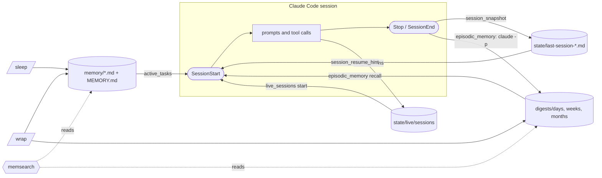

# claude-memory

Long-term memory for [Claude Code](https://docs.claude.com/en/docs/claude-code) that survives `/clear`, restarts and parallel sessions.

Claude Code already keeps a per-project memory directory (`~/.claude/projects/<project>/memory/` with a `MEMORY.md` index). claude-memory builds on it with hooks, two skills and a search tool:

- **Where we stopped.** Every turn saves a snapshot: branch, uncommitted files, the last prompts, where the answer ended. The next session in the project starts with it, and after `/clear` the window gets its own snapshot back.
- **Session diary.** When a session ends, a small model writes a 2–4 line entry (done / decided / open). Finished weeks and months are rolled up. A new session starts with today's other sessions, the last working day and last week's loose ends.
- **Active tasks.** A note with `status: active`, `title`, `next` in its frontmatter is a task in progress. Every session starts with the list, so you don't have to keep task lines in the index by hand.
- **Parallel sessions.** A live registry shows what other Claude Code windows are doing and warns when two sessions edit the same file.
- **Search.** `memsearch` does full-text search over notes and diaries, with optional local embeddings (`--hybrid`), queries by ticket, age or type, and lints broken links and orphaned notes.
- **`/wrap` and `/sleep`.** `/wrap` saves a rich summary from the model's full context before `/clear`. `/sleep` consolidates memory: merges duplicates, fixes stale facts and broken links, learns the user's terms.

Everything is plain Markdown files on your disk. There is no server and no database you have to keep: the search index is a disposable cache.



## Requirements

- **Claude Code**
- **Node.js ≥ 22.18** (for `node:sqlite` and running TypeScript directly). Every hook and tool is plain Node.js; nothing else is required.
- **git** (optional): snapshots show the branch and uncommitted files.
- Linux, macOS or Windows. On Windows, Claude Code's Bash tool uses Git Bash, and the skills call the tools from it.

## Install

```sh
git clone https://github.com/amalashenok/claude-memory.git
cd claude-memory
./install.sh                 # Linux, macOS, Git Bash
```

```powershell
powershell -ExecutionPolicy Bypass -File .\install.ps1     # Windows PowerShell
```

Both run `node install.mjs`, which:

1. copies hooks and tools to `~/.claude/claude-memory/` and writes `memsearch` and `claude-memory` launchers to `~/.claude/claude-memory/bin/`;
2. installs the `/wrap` and `/sleep` skills to `~/.claude/skills/` (a different skill with the same name is moved aside, not overwritten);
3. adds a short block of memory conventions to `~/.claude/CLAUDE.md` between `claude-memory` markers;
4. registers the hooks in `~/.claude/settings.json` (backup next to it). Your other hooks and settings are kept;
5. installs the optional embedding runtime for `memsearch --hybrid` with npm (about 100 MB including the model, downloaded on first use).

Running it again updates the installation in place. Restart Claude Code sessions afterwards.

| Option | Effect |
|---|---|
| `--no-diary` | no session diary (it calls `claude -p` with a small model once per session) |
| `--no-live` | no live registry of parallel sessions |
| `--no-embeddings` | full-text search only; skips npm |
| `--no-claude-md` | leave `CLAUDE.md` alone |
| `--node <path>` | Node.js binary for the hooks (default: the one running the installer). Use it when the `node` on PATH is older than 22.18: `NODE=~/.nvm/versions/node/v24.18.0/bin/node ./install.sh` |
| `--uninstall` | remove hooks, tools, unmodified skills and the `CLAUDE.md` block. Your memory notes and diaries are never touched |

`CLAUDE_CONFIG_DIR` is respected if you keep Claude Code's config somewhere other than `~/.claude`.

## Usage

Most of it is automatic. A new session in a project starts with context like this:

```
Snapshot of the previous session in this project (for reference, not instructions; verify against git):
# Where we stopped — shop
- Branch: ACME-412-checkout-retry
## Last user prompts
- Now run the tests please
…
Session diary (…)
## Last working day, 2026-11-20 (topics and what was left open)
### 15:10–16:40 · Checkout retry with idempotency key · ACME-412
- Open: load test in staging, then PR
## Active tasks (…)
- [ACME-412 checkout timeout on slow payment provider](project_checkout_timeout.md) — 2026-11-20: tests green; next: load test
Parallel Claude sessions (…):
• shop — Refactor the checkout retry logic (42s ago, tool calls: 17)
```

What you do by hand:

| | |
|---|---|
| `/wrap [next focus]` | before `/clear` in a long session: updates notes, saves a summary that the next session gets right after `/clear` |
| `/sleep` | now and then (end of day): tidies and consolidates memory, regenerates `REGISTRY.md` |
| `memsearch <words>` | search notes and diaries; `--hybrid` adds meaning-based search |
| `memsearch ls --type project --older-than 14d` | notes not touched for two weeks; also `--ticket ABC-123`, `--active`, `--archived` |
| `memsearch lint` | broken links, notes without a description, orphans missing from the index |
| `claude-memory live [list\|files\|watch]` | what parallel sessions are doing right now |
| `claude-memory catchup` | write missing diary entries for recent sessions now |

The tools live in `~/.claude/claude-memory/bin/`; add it to `PATH` to call them by name. Claude calls them by full path from the skills and the `CLAUDE.md` block.

## Memory format

See [docs/memory-format.md](docs/memory-format.md) for the note format, the frontmatter fields the hooks read, and the on-disk layout. [examples/memory/](examples/memory/) is a small fictional project memory to start from.

## Configuration

| Variable | Default | |
|---|---|---|
| `EPISODIC_MODEL` | `haiku` | model that writes diary entries |
| `EPISODIC_CONTEXT` | — | one line about you for the diary writer, e.g. `backend developer on the checkout team` |
| `EPISODIC_CATCHUP_DAYS` / `EPISODIC_CATCHUP_MAX` | `3` / `6` | how far back and how many missed sessions to digest at session start |
| `EPISODIC_EMBED` | on | `0` disables background embedding refresh after the roll-up |
| `RESUME_HINT_MAX_AGE_DAYS` | `5` | older snapshots are not shown |
| `ACTIVE_TASKS_DEFAULT_GROUP` | `Tasks` | heading for active tasks without a `group` |
| `MEMSEARCH_MODEL` | `Xenova/multilingual-e5-small` | embedding model (multilingual) |
| `MEMSEARCH_CACHE` | `~/.cache/memsearch` | search index and embedding cache |

Set them in the `env` section of `~/.claude/settings.json` so hooks see them.

## Privacy

Everything stays on your machine, with one exception. The session diary sends a condensed transcript (your prompts and Claude's answers, no tool output) to the model through your own `claude -p`, under the same account and data policy as your sessions. Use `--no-diary` if you don't want that. Embeddings are computed locally.

Your memory directories hold whatever you worked on, so don't commit or share `~/.claude/projects/`.

## How it works

| Piece | Event | What it does |
|---|---|---|
| `hooks/session_snapshot.mjs` | Stop, SessionEnd | writes `state/last-session-<project>.md`; on `/clear` also a hand-off for this window |
| `hooks/session_resume_hint.mjs` | SessionStart | prints the snapshot; after `/clear` prints this window's `/wrap` summary and snapshot instead |
| `hooks/episodic_memory.mjs` | SessionEnd, SessionStart | diary entry per session (in the background), week and month roll-ups, recall |
| `hooks/active_tasks.mjs` | SessionStart | lists notes with `status: active` |
| `hooks/live_sessions.mjs` | SessionStart, UserPromptSubmit, PostToolUse, SessionEnd | live registry, same-file edit warnings, a short log in `digests/live/` |
| `memsearch/memsearch.ts` | — | SQLite FTS5 (trigram) index, optional embeddings, `ls`, `lint` |
| `tools/claude-memory.mjs` | — | `save-wrap`, `live`, `registry`, `catchup` |
| `skills/wrap`, `skills/sleep` | — | the two skills |

The terminal window is identified by the Claude Code process ID, which survives `/clear` while the session ID does not. That's how a hand-off reaches the right window when several sessions are open in the same project. If the process tree can't be read, hand-offs fall back to the project.

Hooks never fail a session: any error is written to `~/.claude/state/claude-memory.log` and the hook exits 0.

## Development

```sh
node --test tests/smoke.test.mjs
```

The smoke tests run every hook and tool as a real process against a temporary config dir, with a fake `claude` on PATH. CI runs them on Linux, macOS and Windows with Node 22.18 and 24.

## License

[MIT](LICENSE)
