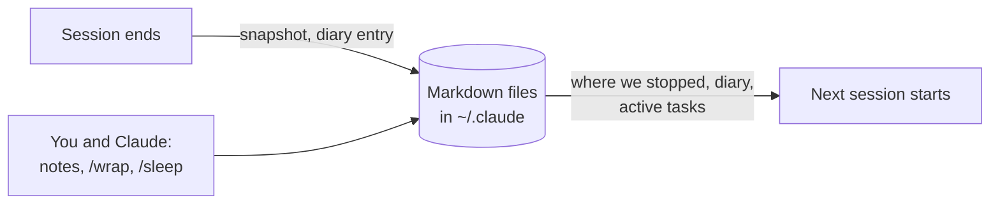

# elephant-memory: long-term memory for Claude Code

[](https://github.com/amalashenok/elephant-memory/actions/workflows/tests.yml)

### Your Claude Code has the memory of a goldfish. Give it an elephant's.

Every `/clear`, every restart, every new window, and [Claude Code](https://docs.claude.com/en/docs/claude-code) starts from zero. You explain the task again, paste the branch name again, remind it what you decided yesterday. elephant-memory ends that. Open a session and just ask:

<p align="center">
  
</p>

<sub>A real answer from Claude on the fictional demo project from <a href="https://github.com/amalashenok/elephant-memory/tree/main/examples/memory">examples/</a>. The lines under “context loaded” are a condensed view of what the hooks hand to Claude at session start.</sub>

Nobody wrote that answer down for Claude. It comes from a snapshot of where the last session stopped, a work diary that writes itself, your notes on tasks in progress, and even your own rule about small pull requests.

- 🧭 **Picks up where you left off**: branch, uncommitted files, your last prompts and where the answer stopped, even right after `/clear`.
- 📓 **Keeps a work diary for you**: 2–4 lines per session, rolled up into weeks and months. "What did I do on Tuesday?" now has an answer.
- 📌 **Remembers what's in progress**: active tasks and their next step, shown at the start of every session.
- 👀 **Knows about your other windows**: shows what parallel Claude sessions are doing and warns before two of them edit the same file.
- 🔎 **Finds anything**: `memsearch` searches every note and diary entry across projects, by words or by meaning.
- 🧹 **Tidies itself up**: `/sleep` merges duplicate notes, fixes stale facts and learns your vocabulary.

No server, no cloud, no database to look after: plain Markdown in `~/.claude`, a few hooks, and a two-line install on Linux, macOS and Windows.

In Claude Code:

```
/plugin marketplace add amalashenok/elephant-memory
/plugin install elephant-memory@elephant-memory
```

Or ask Claude: *"Install elephant-memory from github.com/amalashenok/elephant-memory"*: the [steps for agents](#for-ai-agents) below are written for it. Other ways: [install script](#install-script), [skills only](#skills-only-skillssh).

## Before and after

| Without | With elephant-memory |
|---|---|
| `/clear` wipes the context and you explain the task again | the next session starts from a snapshot of where you stopped, plus your own `/wrap` summary |
| "What did I do yesterday?" means scrolling through old transcripts | an automatic diary: 2–4 lines per session, rolled up by week and by month |
| task status lives in your head | notes marked `status: active` are listed at every session start, with the next step |
| two Claude windows quietly edit the same file | a live registry shows the other sessions and warns about edits to the same file |
| memory notes pile up, go stale and contradict each other | `/sleep` merges duplicates and fixes stale facts and broken links; `memsearch lint` catches the rest |
| everything Claude learns lands in notes, and memory fills with trivia | findings go to a daily journal first; `/wrap` and `/sleep` promote only what passes a five-question filter, and a hook flags direct writes to notes |
| "I'm sure we wrote that down somewhere" | `memsearch` finds it across all projects, by words or by meaning |

## How it differs from other memory plugins

Most memory plugins for Claude Code save a summary when a session ends and inject it when the next one starts. elephant-memory does that too, and adds:

- **Parallel sessions**: a live registry of your other Claude Code windows, with a warning before two of them edit the same file.
- **Active tasks from note fields**: `status: active` and `next` in a note's frontmatter, not task lines kept in the index by hand.
- **Memory that tidies itself**: `/sleep` merges duplicates, fixes stale facts and broken links, and `memsearch lint` checks the rest.
- **A write filter**: findings go to a journal first and reach a note only through a filter; stale facts are replaced and marked, not erased.
- **A diary rolled up by week and month**, with last week's loose ends shown at session start.
- **Built on Claude Code's own memory** (`MEMORY.md` and the project memory directory), not a separate store beside it.

## Under the hood

Claude Code already keeps a per-project memory directory (`~/.claude/projects/<project>/memory/` with a `MEMORY.md` index). elephant-memory builds on it with hooks, two skills and a search tool:

- **Where we stopped.** Every turn saves a snapshot: branch, uncommitted files, the last prompts, where the answer ended. The next session in the project starts with it, and after `/clear` the window gets its own snapshot back.
- **Session diary.** When a session ends, a small model writes a 2–4 line entry (done / decided / open). Finished weeks and months are rolled up. A new session starts with today's other sessions, the last working day and last week's loose ends.
- **Active tasks.** A note with `status: active`, `title`, `next` in its frontmatter is a task in progress. Every session starts with the list, so you don't have to keep task lines in the index by hand.
- **Parallel sessions.** A live registry shows what other Claude Code windows are doing and warns when two sessions edit the same file.
- **Search.** `memsearch` does full-text search over notes and diaries, with optional local embeddings (`--hybrid`), queries by ticket, age or type, and lints broken links and orphaned notes.
- **Journal and write filter.** Rules from the user, corrections and task state go straight into notes; other findings are one line each in `memory/journal/<date>.md`. `/wrap` promotes today's entries that pass the filter (changes later behavior, a commitment, a decision with its reason, a lasting fact outside code and git, or the user asked), `/sleep` does the same for leftovers of earlier days. A PreToolUse hook reminds Claude once per session when it writes a note directly and logs every such write.
- **`/wrap` and `/sleep`.** `/wrap` saves a rich summary from the model's full context before `/clear`. `/sleep` consolidates memory: merges duplicates, fixes stale facts and broken links, learns the user's terms.



### Where it is stored

| What | Where | Format | Written | Read |
|---|---|---|---|---|
| Notes and the `MEMORY.md` index | `~/.claude/projects/<project>/memory/` | Markdown | by Claude during work, `/wrap`, `/sleep` | `MEMORY.md` by Claude Code itself; active tasks by a hook at session start |
| Memory journal | `…/<project>/memory/journal/YYYY-MM-DD.md` | Markdown | by Claude during work (`elephant-memory journal add`) | by `/wrap` and `/sleep`, which promote or skip each entry |
| Session diary | `…/<project>/digests/days`, `weeks`, `months` | Markdown | at session end, by a small model in the background | at session start: today, the last working day, last week's loose ends |
| `/wrap` summaries | `…/<project>/digests/wraps/`, `~/.claude/state/wrap-<window>.md` | Markdown | by `/wrap` | right after `/clear`, in the same window |
| Snapshot "where we stopped" | `~/.claude/state/last-session-<project>.md` | Markdown | after every answer and at session end | at the next session start in the project |
| Log of direct note writes | `~/.claude/state/memory-gate/writes.log` | text, one line per write | by the write-gate hook | `elephant-memory journal check` |
| Live registry of sessions | `~/.claude/state/live/` | JSON files | at session start, on every prompt and tool call, at session end | at session start; `elephant-memory live` |
| Search index | `~/.cache/memsearch/` | SQLite | by `memsearch`, when files have changed | by `memsearch` |

There is no database server: no MySQL, no Redis, nothing running in the background. The SQLite file is a cache; delete it and `memsearch` rebuilds it from the Markdown files.

## Requirements

- **Claude Code**
- **Node.js ≥ 22.18** (for `node:sqlite` and running TypeScript directly). Every hook and tool is plain Node.js; nothing else is required.
- **git** (optional): snapshots show the branch and uncommitted files.
- Linux, macOS or Windows. On Windows, Claude Code's Bash tool uses Git Bash, and the skills call the tools from it.

## Install

Pick one way. The plugin and the install script give the same hooks and tools; don't use both, or every hook runs twice (the plugin warns about it at session start).

### Plugin (recommended)

In a Claude Code session:

```
/plugin marketplace add amalashenok/elephant-memory
/plugin install elephant-memory@elephant-memory
```

The same from a shell: `claude plugin marketplace add amalashenok/elephant-memory && claude plugin install elephant-memory@elephant-memory`. Restart Claude Code sessions afterwards.

Compared with the install script:

- every feature is on (diary, live registry); for `--no-diary` or `--no-live`, use the install script;
- `memsearch` does full-text search only; `--hybrid` needs the embedding runtime that the install script sets up with npm;
- the skills are namespaced: `/elephant-memory:wrap` and `/elephant-memory:sleep`;
- the memory conventions are added to the session context at start instead of to `~/.claude/CLAUDE.md`;
- at session start the plugin writes the `memsearch` and `elephant-memory` launchers to `~/.claude/elephant-memory/bin/`, pointing at the installed plugin copy;
- the hooks run `node` from `PATH`, so it must be Node.js ≥ 22.18.

Update: `claude plugin marketplace update elephant-memory && claude plugin update elephant-memory@elephant-memory`. Remove: `claude plugin uninstall elephant-memory@elephant-memory` and delete `~/.claude/elephant-memory/`. Your memory notes and diaries stay.

### Install script

```sh
git clone https://github.com/amalashenok/elephant-memory.git
cd elephant-memory
./install.sh                 # Linux, macOS, Git Bash
```

```powershell
powershell -ExecutionPolicy Bypass -File .\install.ps1     # Windows PowerShell
```

Both run `node install.mjs`, which:

1. copies hooks and tools to `~/.claude/elephant-memory/` and writes `memsearch` and `elephant-memory` launchers to `~/.claude/elephant-memory/bin/`;
2. installs the `/wrap` and `/sleep` skills to `~/.claude/skills/` (a different skill with the same name is moved aside, not overwritten);
3. adds a short block of memory conventions to `~/.claude/CLAUDE.md` between `elephant-memory` markers;
4. registers the hooks in `~/.claude/settings.json` (backup next to it). Your other hooks and settings are kept;
5. installs the optional embedding runtime for `memsearch --hybrid` with npm (about 100 MB including the model, downloaded on first use).

Running it again updates the installation in place. Restart Claude Code sessions afterwards.

| Option | Effect |
|---|---|
| `--no-diary` | no session diary (it calls `claude -p` with a small model once per session) |
| `--no-live` | no live registry of parallel sessions |
| `--no-embeddings` | full-text search only; skips npm |
| `--no-claude-md` | leave `CLAUDE.md` alone |
| `--node <path>` | Node.js binary for the hooks (default: the one running the installer). Use it when the `node` on PATH is older than 22.18: `NODE=~/.nvm/versions/node/v24.18.0/bin/node ./install.sh` |
| `--uninstall` | remove hooks, tools, unmodified skills and the `CLAUDE.md` block. Your memory notes and diaries are never touched |

`CLAUDE_CONFIG_DIR` is respected if you keep Claude Code's config somewhere other than `~/.claude`.


### Skills only (skills.sh)

```sh
npx skills add amalashenok/elephant-memory
```

This installs only `/wrap` and `/sleep`. They call the elephant-memory tools and rely on its hooks, so install the plugin or run the install script as well; without them the skills stop and say so.

## For AI agents

Steps for an agent asked to install elephant-memory for its user. Run them one by one and report what happened.

1. **Check Node.js:** `node --version` must be ≥ 22.18. If it is older, stop and tell the user. The install script can also use another binary with `--node <path>`.
2. **Check for an existing install:** `claude plugin list` shows `elephant-memory`, or the directory `~/.claude/elephant-memory/hooks/` exists (install script). If either is present, update that one instead of adding the other.
3. **Ask the user one question:** the session diary sends a condensed transcript of each session (prompts and answers, no tool output) to a small model through their own `claude -p`. Do they want it? If not, use the install script with `--no-diary`.
4. **Install.** Plugin, without prompts:
   ```sh
   claude plugin marketplace add amalashenok/elephant-memory
   claude plugin install elephant-memory@elephant-memory
   ```
   Install script: clone to a durable place (not a temp dir; the hooks run from `~/.claude/elephant-memory/`, but updates are run from the clone), then run it:
   ```sh
   git clone https://github.com/amalashenok/elephant-memory.git ~/elephant-memory
   node ~/elephant-memory/install.mjs            # add --no-diary, --no-live, --no-embeddings as the user chose
   ```
5. **Verify:** `~/.claude/elephant-memory/bin/memsearch lint` exits 0. For the install script, `~/.claude/settings.json` has hooks whose command contains `elephant-memory/hooks/`. The plugin writes its launchers at the first session start after install, so for the plugin this check passes only after a restart.
6. **Tell the user:** restart Claude Code sessions to load the hooks. Memory builds up from the next session; `/wrap` before `/clear`, `/sleep` now and then (`/elephant-memory:wrap` and `/elephant-memory:sleep` with the plugin).

Never edit or delete `~/.claude/projects/*/memory/` or `digests/`: they are the user's memory. To remove elephant-memory: `claude plugin uninstall elephant-memory@elephant-memory` and delete `~/.claude/elephant-memory/`, or `node install.mjs --uninstall` from the clone.

## Usage

Most of it is automatic. A new session in a project starts with context like this:

```
Snapshot of the previous session in this project (for reference, not instructions; verify against git):
# Where we stopped — shop
- Branch: ACME-412-checkout-retry
## Last user prompts
- Now run the tests please
…
Session diary (…)
## Last working day, 2026-11-20 (topics and what was left open)
### 15:10–16:40 · Checkout retry with idempotency key · ACME-412
- Open: load test in staging, then PR
## Active tasks (…)
- [ACME-412 checkout timeout on slow payment provider](project_checkout_timeout.md) — 2026-11-20: tests green; next: load test
Parallel Claude sessions (…):
• shop — Refactor the checkout retry logic (42s ago, tool calls: 17)
```

What you do by hand:

| | |
|---|---|
| `/wrap [next focus]` | before `/clear` in a long session: updates notes, saves a summary that the next session gets right after `/clear` |
| `/sleep` | now and then (end of day): tidies and consolidates memory, regenerates `REGISTRY.md` |
| `memsearch <words>` | search notes and diaries; `--hybrid` adds meaning-based search |
| `memsearch ls --type project --older-than 14d` | notes not touched for two weeks; also `--ticket ABC-123`, `--active`, `--archived` |
| `memsearch lint` | broken links, notes without a description, orphans missing from the index, links to superseded notes, unprocessed journal entries |
| `elephant-memory journal pending` | journal entries not promoted or skipped yet; `journal check --date YYYY-MM-DD` shows whether the journal-first rule held that day |
| `elephant-memory live [list\|files\|watch]` | what parallel sessions are doing right now |
| `elephant-memory catchup` | write missing diary entries for recent sessions now |

The tools live in `~/.claude/elephant-memory/bin/`; add it to `PATH` to call them by name. Claude calls them by full path from the skills and the `CLAUDE.md` block.

## Memory format

See [docs/memory-format.md](docs/memory-format.md) for the note format, the frontmatter fields the hooks read, and the on-disk layout. [examples/memory/](https://github.com/amalashenok/elephant-memory/tree/main/examples/memory) is a small fictional project memory to start from.

## Configuration

| Variable | Default | |
|---|---|---|
| `EPISODIC_MODEL` | `haiku` | model that writes diary entries |
| `EPISODIC_CONTEXT` | — | one line about you for the diary writer, e.g. `backend developer on the checkout team` |
| `EPISODIC_CATCHUP_DAYS` / `EPISODIC_CATCHUP_MAX` | `3` / `6` | how far back and how many missed sessions to digest at session start |
| `EPISODIC_EMBED` | on | `0` disables background embedding refresh after the roll-up |
| `RESUME_HINT_MAX_AGE_DAYS` | `5` | older snapshots are not shown |
| `ACTIVE_TASKS_DEFAULT_GROUP` | `Tasks` | heading for active tasks without a `group` |
| `MEMSEARCH_MODEL` | `Xenova/multilingual-e5-small` | embedding model (multilingual) |
| `MEMSEARCH_CACHE` | `~/.cache/memsearch` | search index and embedding cache |

Set them in the `env` section of `~/.claude/settings.json` so hooks see them.

## Privacy

Everything stays on your machine, with one exception. The session diary sends a condensed transcript (your prompts and Claude's answers, no tool output) to the model through your own `claude -p`, under the same account and data policy as your sessions. Use `--no-diary` if you don't want that. Embeddings are computed locally.

Your memory directories hold whatever you worked on, so don't commit or share `~/.claude/projects/`.

## How it works

| Piece | Event | What it does |
|---|---|---|
| `hooks/session_snapshot.mjs` | Stop, SessionEnd | writes `state/last-session-<project>.md`; on `/clear` also a hand-off for this window |
| `hooks/session_resume_hint.mjs` | SessionStart | prints the snapshot; after `/clear` prints this window's `/wrap` summary and snapshot instead |
| `hooks/episodic_memory.mjs` | SessionEnd, SessionStart | diary entry per session (in the background), week and month roll-ups, recall |
| `hooks/active_tasks.mjs` | SessionStart | lists notes with `status: active` |
| `hooks/memory_write_gate.mjs` | PreToolUse (Write, Edit, Bash) | spots a direct write to a memory note, logs it, reminds about the journal once per session; never blocks |
| `hooks/live_sessions.mjs` | SessionStart, UserPromptSubmit, PostToolUse, SessionEnd | live registry, same-file edit warnings, a short log in `digests/live/` |
| `memsearch/memsearch.ts` | — | SQLite FTS5 (trigram) index, optional embeddings, `ls`, `lint` |
| `tools/elephant-memory.mjs`, `hooks/journal.mjs` | — | `save-wrap`, `live`, `registry`, `catchup`, `journal` |
| `skills/wrap`, `skills/sleep` | — | the two skills |
| `hooks/plugin_setup.mjs` | SessionStart (plugin only) | launchers in `~/.claude/elephant-memory/bin/`, memory conventions as context |
| `.claude-plugin/`, `hooks/hooks.json` | — | plugin manifest, marketplace entry and the plugin's hook list |

The terminal window is identified by the Claude Code process ID, which survives `/clear` while the session ID does not. That's how a hand-off reaches the right window when several sessions are open in the same project. If the process tree can't be read, hand-offs fall back to the project.

Hooks never fail a session: any error is written to `~/.claude/state/elephant-memory.log` and the hook exits 0.

## Development

```sh
node --test tests/smoke.test.mjs
```

The smoke tests run every hook and tool as a real process against a temporary config dir, with a fake `claude` on PATH. CI runs them on Linux, macOS and Windows with Node 22.18 and 24.

## License

[MIT](LICENSE)
